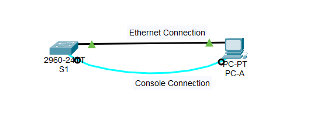

# View Network Device MAC Addresses Lab

**Date:** November 2026

**Security Domain:** Network Infrastructure

**Tools & Hardware Used:** Cisco Packet Tracer, Cisco Catalyst 2960 Switch, Windows PC, Cisco IOS CLI

---

## 1. Scenario & Objective

The objective of this lab was to configure a switch and workstation, verify network connectivity, and examine Ethernet MAC addresses on network devices. This lab provided hands-on experience with Layer 2 addressing and demonstrated how switches use MAC addresses to identify and forward traffic on a local network.

---

## 2. Architecture & Design

*Figure 1. Cisco Packet Tracer topology showing a Catalyst 2960 switch connected to a workstation via Ethernet and console connections for MAC address analysis and device configuration.*

### Addressing Information

| Device | Interface | IP Address |
|----------|----------|----------|
| S1 | VLAN 1 | 192.168.1.2 |
| PC-A | NIC | 192.168.1.3 |

---

## 3. Methodology & Execution

### Initial Assessment

The topology consisted of a single switch and a workstation connected through FastEthernet 0/6. Before examining MAC addresses, the devices needed to be configured according to the addressing table and tested for connectivity.

### Configuration / Execution

1. Configured the management interface on Switch S1.
2. Assigned the IP address 192.168.1.2 to VLAN 1.
3. Configured PC-A with the IP address 192.168.1.3.
4. Verified physical connectivity between the switch and workstation.
5. Performed connectivity testing using ICMP ping.
6. Used Cisco IOS commands to display MAC address information.
7. Examined MAC addresses on both the workstation and switch.

### Reasoning

Understanding MAC addresses is essential because Ethernet communication relies on Layer 2 addressing. The switch learns MAC addresses dynamically and stores them in its MAC address table to determine where to forward frames.

### Validation

Successful ping tests confirmed network connectivity between the switch and workstation. MAC address information was displayed successfully through both the operating system and Cisco IOS commands.

---

## 4. Challenges & Troubleshooting

### Issue Encountered

Initial connectivity testing required verification that both devices had been assigned the correct addresses and were operating on the same network.

### Troubleshooting Steps

- Verified cable connections.
- Confirmed IP addressing configuration.
- Checked interface status on the switch.
- Reviewed VLAN 1 configuration.
- Retested connectivity using ping commands.

### Resolution

After verifying device configurations, connectivity was confirmed and MAC address information could be successfully collected and analyzed.

---

## 5. Conclusion & Lessons Learned

### Final Outcome

The lab successfully demonstrated how MAC addresses are used on an Ethernet network and how switches learn and maintain MAC address tables to forward traffic efficiently.

### Lessons Learned

- MAC addresses operate at Layer 2 of the OSI Model.
- Switches dynamically learn MAC addresses from incoming traffic.
- Network connectivity should always be verified before troubleshooting higher-layer issues.
- Cisco IOS provides valuable commands for viewing and analyzing switch information.

### Security Recommendations

- Monitor MAC address tables for unauthorized devices.
- Implement port security to limit allowed MAC addresses.
- Disable unused switch ports to reduce attack surfaces.
- Regularly review network device configurations for security compliance.
